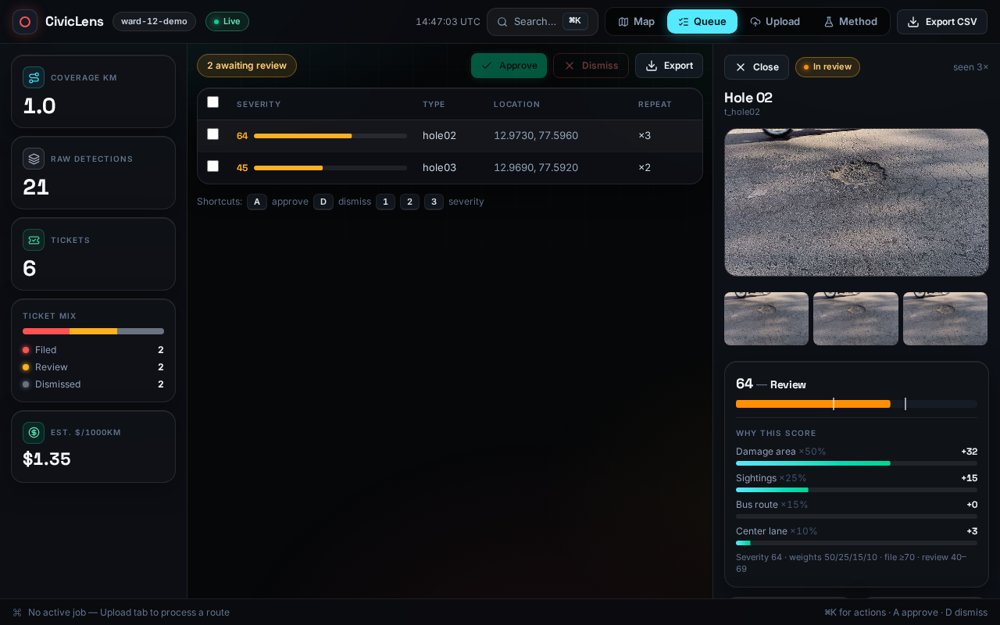
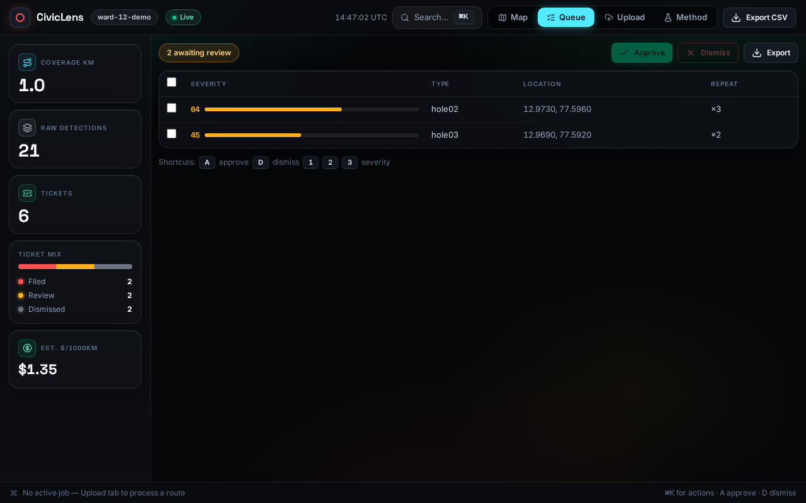
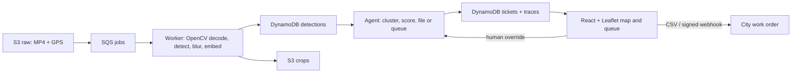

# CivicLens

**Fleet dashcams that file their own pothole tickets, with photo proof and a decision trace for every work order.**

OpenCV AI Competition 2026 submission. The live demo runs on a 2 GB ARM instance against a seeded Ward 12.

[Live demo](http://3.25.238.76) · [API docs](http://3.25.238.76:8000/docs) · [Technical report](docs/report.md) · [Results](docs/report.md#8-evaluation-results)

[](https://github.com/Divyanshu-kumar14/CivicLens/actions/workflows/ci.yml)
[](https://opencv.org/)
[](https://www.python.org/)
[](https://react.dev/)
[](LICENSE)



The ticket drawer on the local demo dataset: a pothole crop, the severity score, and the factors behind the review gate. The live demo runs the same UI against real AWS services.

## The problem

Cities find potholes by patrol or by complaint. Patrols sample the network instead of covering it. Complaints arrive late, often without a photo or a GPS fix, and usually several times for the same hole. The work-order desk then triages without a severity signal, so a cracked lane and a wheel-eating crater compete for the same crew. The loop produces no before/after evidence for contractors or grant applications.

The cost is measurable:

- US drivers spent **$26.5B** on pothole-related repairs in 2021; 1 in 10 hit damage worth repairing, averaging almost **$600** ([AAA, 2022](https://newsroom.aaa.com/2022/03/aaa-potholes-pack-a-punch-as-drivers-pay-26-5-billion-in-related-vehicle-repairs/)).
- **2,161 people** died in pothole-related crashes in India in 2023, up **16.4%** year on year ([Ministry of Road Transport & Highways annual report, via Times of India](https://timesofindia.indiatimes.com/india/potholes-claimed-2161-lives-in-2023-wrong-side-driving-9432/articleshow/123569966.cms)).

The demo ward sits in Bengaluru, inside that network. The pixels already exist: garbage trucks, sweepers, and buses drive every street on a weekly schedule with dashcams fitted. CivicLens attaches the missing step. Video plus GPS in, deduplicated and severity-ranked tickets out, each with a photo and a decision trace.

## What CivicLens does

CivicLens turns an existing municipal fleet into a road inspector. A dashcam records the route, a GPS track supplies location, and the pipeline detects road damage, blurs faces and plates before storage, deduplicates repeat sightings, scores severity, and files, queues, or dismisses a ticket. The city gets a ranked queue and CSV or webhook export instead of a patrol backlog.

What makes it useful:

- **Use the fleet you have.** No new hardware. The dashcam and GPS unit are already on the truck.
- **One ticket per hole.** GPS plus ORB embeddings collapse repeat sightings; the live demo uses the GPS-only path that fits the 2 GB box.
- **Rank the queue.** Weighted severity and the 70/40 gates separate auto-file, review, and dismiss; an arterial ticket at 85 or higher is forced to human review.
- **Keep the decision auditable.** Every file, queue, or dismiss appends a trace with the contributing factors. A human override uses the same log. There is no LLM in the decision path; the "agent" is a deterministic rules engine.
- **Blur before storage.** Haar face and plate cascades run on each crop before it reaches S3.

## See it work

**Live demo:** [http://3.25.238.76](http://3.25.238.76)
**API docs:** [http://3.25.238.76:8000/docs](http://3.25.238.76:8000/docs)
**Technical report:** [docs/report.md](docs/report.md)

The live box is a single AWS `t4g.small` in `ap-southeast-2` with real S3, SQS, and DynamoDB. It runs the classical worker, not the YOLO image. The demo is seeded with Ward 12 tickets, and the map, review queue, ticket drawer, override, and CSV export all run against that instance.

Try it in a browser:

1. Open the live demo and click a pin or a queue row.
2. In the ticket drawer, check the crop, the factors behind the score, and the trace.
3. Approve or dismiss a pending ticket, then export the filed tickets as CSV.
4. Use Upload to process a short MP4. The worker writes an annotated video and stores the crops.

The public box is for demo data. Do not upload personal or sensitive footage.



The review queue on the local demo dataset, with two pending tickets and the severity bars used for triage. The live demo runs the same UI.

## How it works

### The request path

1. **Upload or enqueue.** `POST /jobs/upload` takes a video (2 GB maximum) and an optional GPS file; `POST /jobs` accepts S3 URLs. The API writes the raw object, creates a `cl-jobs` row, and sends a message to `civic-lens-jobs`.
2. **Process.** The worker downloads the video, decodes keyframes with OpenCV, detects potholes and cracks, blurs faces and plates, writes blurred crops to S3, and records detections in DynamoDB.
3. **Decide.** `DeduplicatorService` clusters sightings, `SeverityScorer` computes the weighted score, and `TicketFiler` files at 70 or above, queues at 40 to 69, and dismisses below 40. An arterial ticket at 85 or above is forced to review instead of auto-filing.
4. **Surface and act.** The React app reads tickets through the API. A reviewer can override a ticket, and the override appends to the same trace. Filed tickets export to CSV or go out through a signed webhook.

The live demo runs `agent.demo_worker.py`, which performs the same intake, detection, dedup, scoring, filing, and annotated video steps in one container with the classical detector. The full vision image splits detection into `vision/pipeline.py` and adds YOLO and ORB. The [report](docs/report.md#5-aws-deployment) records the live path.

### OpenCV in the pipeline

OpenCV does the CPU work on the fleet box. The pinned version is 5.0.0.93 (contrib headless).

- **Decode and sample:** `cv2.VideoCapture` reads the dashcam file; the pipeline samples keyframes instead of every frame.
- **Classical detection:** `vision/classical.py` blurs, runs Canny at 50/150, dilates, finds external contours, filters by area above 500 px and aspect ratio 0.3 to 3.0, applies a perspective-normalized y-depth area, and checks the center lane.
- **YOLO fusion:** `vision/detector.py` runs YOLOv8n at confidence 0.25 and NMS 0.5 with a 24 px minimum box. A YOLO/classical overlap adds 0.1 confidence; large classical-only regions enter at 0.45; borderline hits get an ROI re-check.
- **Privacy blur:** `vision/blur.py` runs Haar face and plate cascades per crop, with a plate-shape edge-density fallback. The demo worker applies the same `PrivacyBlur`.
- **Dedup embedding:** `vision/embedder.py` turns an ORB-500 mean into a 128-dimensional unit vector. Inputs are capped at 128 px; that cap took ORB from 11.5 ms to 1.8 ms per crop with the same similarity behavior ([perf ledger](docs/PERF.md)).
- **Overlay:** the worker draws annotated boxes back onto the video for review.

### Dedup and severity

`agent/services/cluster.py` clusters by combined GPS and visual distance: `geo_eps_m = 15`, `cos_thresh = 0.82`, `min_samples = 2`. A lone weak hit at confidence 0.5 or below is dismissed. The live demo uses GPS-only dedup because the 2 GB box does not load the ORB/vision image; the full agent path runs the combined ORB+GPS dedup.

`agent/services/scorer.py` uses:

```text
severity = 100 * (0.50 * area_norm + 0.25 * repeat_norm + 0.15 * route_w + 0.10 * lane_w)
```

At 70 or above the ticket files; 40 to 69 goes to review; below 40 is dismissed. At 85 or above on an arterial route, the ticket is forced to review. Each ticket's signals carry the per-factor point contributions and the active thresholds, and its trace records the factors behind the outcome.

A real auto-file trace from the report:

```jsonl
{"actor": "agent", "from_status": "new", "reasons": ["severity 73 >= 70"], "signals": {"area_norm": 46.1, "bus_route_w": 100.0, "center_lane": 100.0, "repeat": 100.0}, "to_status": "filed", "ts": "2026-10-09T18:31:56Z"}
```

Human overrides append with `"actor": "human"` and a reason, so the full decision history stays in one place.

## Architecture



The backend runs in two images: the vision worker (`infra/Dockerfile.vision`) and the API (`infra/Dockerfile.agent`). The React app is built by `infra/Dockerfile.web` and served by Nginx. The live box runs a smaller demo worker from the agent image because 2 GB cannot hold torch. The rendered diagram is [`docs/arch_diagram.png`](docs/arch_diagram.png); the editable source is [`docs/arch_diagram.mmd`](docs/arch_diagram.mmd).

For a live upload, the browser sends the file to Nginx, which proxies `/jobs/upload` to FastAPI. FastAPI writes S3 and SQS, `agent.demo_worker` pulls the message and writes detections and tickets, and the browser polls the job and reads the ticket list. The web Nginx also injects the override bearer token server-side, so the token never ships in the browser bundle.

## Tech stack

| Layer | Stack | What it does |
| --- | --- | --- |
| Vision | Python 3.11, OpenCV 5.0.0.93 (contrib headless), NumPy 2.4, Ultralytics 8.4 / YOLOv8n, scikit-learn 1.9 | decode, classical detection, YOLO fusion, ORB, blur, DBSCAN |
| API and worker | FastAPI 0.143, Pydantic 2.14, Gunicorn 26 / Uvicorn 0.54, boto3 1.43 | HTTP routes, job orchestration, AWS calls |
| Web | React 19, Vite 6, Tailwind 4, Leaflet 1.9, Axios 1.7, Node 20 build | map, queue, upload, ticket drawer |
| Data | S3, DynamoDB, SQS | raw video and crops, tickets and traces, jobs |
| Local parity | Docker Compose, LocalStack 3.0, DynamoDB Local | run the AWS flow without an account |
| Deploy and CI | EC2 `t4g.small` (Graviton), Nginx, CloudWatch, GitHub Actions | live demo, metrics, tests on Python 3.11 and 3.12 |

The live path is CPU-only. The YOLO image is separate and needs a pothole-trained checkpoint before its detector numbers mean anything.

## Run it locally

You need Docker with Compose. The seed script and tests use Python 3.11 or 3.12; Node 20 is only needed if you build the web app outside Docker. The local stack uses LocalStack 3.0 and DynamoDB Local, so no AWS account is required.

```bash
# 1. Clone and enter
git clone https://github.com/Divyanshu-kumar14/CivicLens.git
cd CivicLens

# 2. Python environment for the seed script and the tests
python3.12 -m venv .venv
. .venv/bin/activate
pip install -r agent/requirements.lock

# 3. API :8000, web :3000, LocalStack :4566, DynamoDB :8100, demo worker
docker compose up --build -d

# 4. Seed the Ward 12 demo; the first run also creates the local tables
AWS_REGION=us-east-1 \
AWS_ENDPOINT_URL=http://localhost:4566 \
DYNAMO_ENDPOINT_URL=http://localhost:8100 \
AWS_ACCESS_KEY_ID=test AWS_SECRET_ACCESS_KEY=test \
make seed-demo

# 5. Open the map
xdg-open http://localhost:3000
```

The first build takes a few minutes. Expect five seeded Ward 12 tickets (filed, pending, dismissed) with severity, repeat counts, and traces. If the worker exits once while LocalStack creates the queue on a cold start, the restart policy brings it back; if the first job is lost, upload again. If the API is still starting when the seed finishes, give it a moment and reload.

| Service | URL |
| --- | --- |
| Web | `http://localhost:3000` |
| API and interactive docs | `http://localhost:8000`, `http://localhost:8000/docs` |
| LocalStack | `http://localhost:4566` |
| DynamoDB Local | `http://localhost:8100` |

Reset the local demo with `docker compose down -v` and rerun the seed. When the API returns zero pending tickets, the queue shows three client-side sample rows; they yield to real data and never touch the API. The demo crops in `web/public/demo-crops/` back the ticket drawer until an upload stores real S3 crops.

## Configuration

Tunables live in `config.yaml`; environment variables override them for deployments. The full environment list is in [`.env.example`](.env.example).

```yaml
ward: "ward-12-demo"
dedup: { geo_eps_m: 15, cos_thresh: 0.82, min_samples: 2 }
severity: { w_area: 0.50, w_repeat: 0.25, w_route: 0.15, w_lane: 0.10,
  auto_file_threshold: 70, review_threshold: 40 }
privacy: { blur_faces: true, blur_plates: true, raw_retain_days: 14 }
detection: { model: "yolov8n", weights: "", conf_threshold: 0.25, nms_iou: 0.5,
  min_box_px: 24, classes: [pothole, crack] }
embedding: { dim: 128, method: "orb" }
```

Set `detection.weights` to a road-damage checkpoint path to replace the shipped COCO weights (see [`docs/TRAINING.md`](docs/TRAINING.md)); empty means the hub `model` plus the classical fallback.

| Variable | Purpose |
| --- | --- |
| `AWS_REGION` | All AWS calls |
| `S3_RAW_BUCKET` / `S3_CROPS_BUCKET` | Uploaded video and blurred crops |
| `DYNAMO_TABLE_DETECTIONS` / `_TICKETS` / `_JOBS` | Table names |
| `SQS_QUEUE_URL` | Work queue; missing means `500 SQS_QUEUE_URL not configured` |
| `WEBHOOK_SECRET` | HMAC-SHA256 `X-CivicLens-Signature`; also the override bearer token when `ADMIN_SECRET` is unset |
| `ADMIN_SECRET` | Bearer token for `POST /tickets/{id}/override` |
| `CITY_WEBHOOK_URL` | Auto-file notification target |
| `CORS_ORIGINS` | Comma-separated web origins |
| `AWS_ENDPOINT_URL` / `DYNAMO_ENDPOINT_URL` | Local emulator endpoints |
| `CIVICLENS_CONFIG` | Alternate config path |

Key knobs: raise `dedup.geo_eps_m` for fewer, larger clusters (safe range 10 to 30 m); raise `dedup.cos_thresh` for stricter visual matching (0.75 to 0.90); raise `severity.auto_file_threshold` to file less aggressively (60 to 80); lower `detection.conf_threshold` to catch more at the cost of queue noise (0.15 to 0.40).

## API

The local base is `http://localhost:8000`; the live base is `http://3.25.238.76:8000`. Full schemas are at `/docs`.

| Method | Endpoint | Description |
| --- | --- | --- |
| `GET` | `/health` | Liveness probe, returns `{"status": "ok", "service": "civiclens-agent"}` |
| `POST` | `/jobs` | Queue by URL (JSON `video_url`, `gps_url`, `ward`) |
| `POST` | `/jobs/upload` | Multipart upload (`video`, optional `gps`, `ward`) |
| `GET` | `/jobs/{job_id}` | Job status (`queued`, `processing`, `completed`, `failed`) plus progress; failures carry the cause, and a re-delivered completed job returns cached counts without re-filing |
| `GET` | `/tickets?status=&sort=` | List; `status` is filed, pending, or dismissed; `sort` is severity or timestamp |
| `GET` | `/tickets/{ticket_id}` | Full ticket with signals and trace |
| `POST` | `/tickets/{ticket_id}/override` | Human override (`to`: filed, pending, or dismissed; `reason`); requires a bearer token |
| `GET` | `/export.csv?status=filed` | CSV work-order export |
| `POST` | `/webhooks/test` | Signed webhook delivery check |

```bash
curl -X POST http://localhost:8000/jobs/upload \
  -F "video=@route.mp4" \
  -F "gps=@route.csv" \
  -F "ward=ward-12-demo"

curl http://localhost:8000/jobs/<job_id>
curl "http://localhost:8000/tickets?status=pending&sort=severity"
curl "http://localhost:8000/export.csv?status=filed" -o tickets-filed.csv
```

Override with `ADMIN_SECRET`, or `WEBHOOK_SECRET` when `ADMIN_SECRET` is unset:

```bash
curl -X POST http://localhost:8000/tickets/t_hole02/override \
  -H "Authorization: Bearer $ADMIN_SECRET" \
  -H "Content-Type: application/json" \
  -d '{"to": "filed", "reason": "confirmed on site"}'
```

Video intake caps at 2 GB (`413` above that). Filenames must use `mp4`, `mov`, `avi`, or `mkv`; GPS files use `csv` or `srt`, or the API returns `422`. Exported tickets reject override with `409` until re-opened. Presigned crop URLs expire after 15 minutes and re-issue on read.

## Results

The evaluation is split by what it measures because one "accuracy" number would hide the gaps.

| Check | Result | Target | Status |
| --- | --- | --- | --- |
| Dedup compression (synthetic route, full path) | 80 sightings into 9 clusters, 8.89x | Above 5x | Pass |
| Dedup precision / recall | 1.00 / 0.88 | Above 0.90 / 0.80 | Pass |
| Duplicate rate / false tickets per route | 0.11 (1 extra) / 0.0 | As low as possible | Informational |
| Severity rank agreement | Spearman rho 1.00 | At or above 0.70 | Pass |
| Classical fallback P/R (pothole) | 0.29 / 0.50 | N/A, fallback only | Informational |
| Classical P/R (crack) | No labeled samples | Needs crack boxes | Open |
| Fused YOLO plus classical | Needs pothole-trained weights | Above 0.70 P/R | Open |

The dedup and severity checks are strong on the synthetic set; the detector is not. The live demo runs the classical fallback, so its job output is noisier than the fused system the code describes. We report the gap instead of hiding it. Severity rank is perfect, but absolute calibration skews low on the synthetic data.

A live smoke test on 2026-10-23 completed a full upload, worker, and cluster run over the public URL in 4 s: 21 raw detections became 4 clusters, and the worker wrote an annotated video to S3 ([report](docs/report.md#5-aws-deployment)). The full suite is green: 62 passed in `agent/`, 33 passed + 2 skipped in `vision/`. The web initial bundle is 139.29 KB gzip; YOLOv8n measured 356 ms per frame on a 2 vCPU ARM host. Both are reference numbers; rerun `make bench` and `vite build` on your hardware before quoting them.

Reproduce:

```bash
python eval/eval_dedup.py
python eval/eval_severity.py
python eval/eval_detector.py
make bench
make test
```

## What is real vs simulated

| Capability | Live demo (`3.25.238.76`) | Full repository |
| --- | --- | --- |
| Intake, S3, SQS, jobs, map, queue, override, CSV | Real AWS services with seeded Ward 12 data and test uploads | Same |
| Detection | Classical Canny contour path in `agent.demo_worker` | YOLOv8n plus classical fusion in `vision/pipeline.py` |
| Pothole-trained YOLO | Not loaded; COCO weights have no pothole class | Code path ready; needs a checkpoint ([training](docs/TRAINING.md)) |
| Dedup | GPS distance only | ORB plus GPS DBSCAN in `agent/services/cluster.py` |
| Blur | Haar face/plate on each crop; cascades fetched at build | Same |
| Webhook delivery | Endpoint implemented and tested; live target is not configured | Same code; set `CITY_WEBHOOK_URL` |
| Data | Seeded demo and test runs | No city pilot; synthetic route and engineer-ranked set |
| Decision layer | Deterministic 70/40 rules plus trace | Same; no LLM |

The queue's sample rows and the demo crop fallback are presentation aids, not model output. Real uploads replace the demo crops with blurred S3 crops.

## Failure cases

The full log, with measured and expected entries, is in [`eval/failure_cases/README.md`](eval/failure_cases/README.md).

| Failure | What the system does | Status |
| --- | --- | --- |
| Night / low light | Canny 50/150 yields few edges on dark frames and YOLO confidence collapses; the job can silently miss | Open; needs night footage and gain-normalized thresholds |
| Rain glare | Wet reflections create strong edges; low-confidence classical boxes mostly queue or die at the 0.45 gate | Open; glare rejection and a rain split |
| Speed breakers | Pass the aspect and area gates; likely a pending ticket, not a false filing | Open; explicit negatives and a full-lane width cue |
| Tar patches | Dark repair patches pass shape filters; ORB texture keeps them separate; a reviewer dismisses once | Open; texture-aware scoring |
| GPS drift | One hole split into two clusters in the dedup eval; recall 0.88 | Measured; tune `geo_eps_m` or smooth the track |
| Missing or invalid GPS | Sightings are dropped and logged before clustering; no null-island ticket | Fixed and tested; short dropouts are dropped, not interpolated |
| YOLO COCO weights | No pothole or crack class; YOLO contributes nothing and classical carries | Open; train on RDD2020 or fleet data |

LocalStack is pinned to 3.0 because 4.x needs a token. This affects local development only.

## Privacy and responsible use

Faces and plates are blurred before any crop is stored. The agent image fetches Haar cascades at build; if that step is skipped, the worker logs a warning and stores the crop unblurred, so check the worker log after a deploy. Raw video has a 14-day lifecycle; detections expire after 90 days; storage uses SSE-S3; webhooks sign with HMAC-SHA256; crop URLs are 15-minute presigned; CORS is allowlisted. Every ticket ships as verify-on-site advisory, with no auto-dispatch.

Production retention is enforced by `infra/scripts/setup-aws.sh` (raw-bucket 14-day lifecycle, detection-table 90-day TTL). The local LocalStack bootstrap sets neither, so local runs are not retention proof.

## Project structure

```text
agent/       FastAPI routes, demo worker, cluster/score/file services, AWS clients
vision/      OpenCV detector, classical fallback, blur, ORB embedder, GPS, pipeline
web/src/     React map, review queue, upload, ticket drawer, API client
infra/       Dockerfiles, Compose stacks, Nginx, AWS setup, CloudWatch dashboard
eval/        Detector/dedup/severity evals, bench, failure cases, datasets
scripts/     Demo seeder, GPS simulator, synthetic video, cascade fetch
docs/        Technical report, training, perf, security, architecture, images
config.yaml  Shared detection, dedup, severity, and privacy settings
```

Docker images install pinned locks: `agent/requirements.lock`, `vision/requirements.lock`, and `web/package-lock.json`. `make install` uses the looser ranges for local development. The root `requirements.lock` is an index of the per-image locks, not a pip file.

## Tests and CI

GitHub Actions `CI` installs `agent/requirements.lock` and runs `make test` on Python 3.11 and 3.12. The suite is green: 62 passed in `agent/`, 33 passed + 2 skipped in `vision/`.

```bash
python3.12 -m venv .venv
. .venv/bin/activate
pip install -r agent/requirements.lock
make test
```

The agent lock carries pytest and the OpenCV 5, NumPy, SciPy, scikit-learn, FastAPI, and boto3 packages both suites import. `vision/requirements.lock` adds torch and ultralytics for the YOLO image; the tests skip cleanly when those are absent. `make lint` runs flake8 and the web eslint; `make secrets` runs gitleaks or a grep fallback. Commits follow Conventional Commits.

## Deployment

The live demo is one EC2 `t4g.small` in `ap-southeast-2`, running `agent-api` and `web` from `infra/docker-compose.prod.yml`, plus a separate `cl-worker` container running `agent.demo_worker`. It uses real S3, DynamoDB, SQS, and an instance role, so the box stores no AWS access keys.

### 1. Create the resources once

```bash
AWS_REGION=ap-southeast-2 ./infra/scripts/setup-aws.sh
```

The script prints `SQS_QUEUE_URL` when it finishes.

### 2. Configure `.env`

```bash
cp .env.example .env
```

Set `AWS_REGION`, `SQS_QUEUE_URL`, `WEBHOOK_SECRET` (`openssl rand -hex 32`), and `CORS_ORIGINS` to the public web origin.

### 3. Start the API and web

```bash
docker compose -f docker-compose.yml -f infra/docker-compose.prod.yml \
  up --build --no-deps -d agent-api web
```

The base file supplies the build contexts. The prod overlay replaces the LocalStack and DynamoDB Local endpoints with real AWS values. `--no-deps` leaves out the local emulators.

### 4. Start the demo worker

```bash
docker build -t civiclens-agent-api -f infra/Dockerfile.agent .
docker run -d --name cl-worker --restart unless-stopped \
  --env-file .env civiclens-agent-api python -m agent.demo_worker
```

The worker runs outside the compose services so it can be restarted without touching the API. It polls the same SQS queue the API writes to. Its image is the same `infra/Dockerfile.agent` the API uses; the command overrides gunicorn.

The web Nginx proxies `/jobs`, `/tickets`, `/export.csv`, `/webhooks`, and `/health` to the agent and injects the override bearer token server-side. A CloudWatch dashboard template ships in `infra/cloudwatch/dashboard.json`. The full YOLO/ORB worker uses `infra/Dockerfile.vision` and needs more than the 2 GB demo box; the live deployment uses the demo worker by design.

Open pre-pilot item: the instance role currently uses managed S3, DynamoDB, and SQS policies. A ward-scoped IAM policy is the next step before a real fleet deployment.

## Submission checklist

| Requirement | Where |
| --- | --- |
| Technical report | [`docs/report.md`](docs/report.md) |
| Public, judge-accessible repository | [github.com/Divyanshu-kumar14/CivicLens](https://github.com/Divyanshu-kumar14/CivicLens) |
| Pinned dependencies | `agent/requirements.lock`, `vision/requirements.lock`, `web/package-lock.json` |
| Build, deploy, and test instructions | [Run it locally](#run-it-locally), [Tests and CI](#tests-and-ci), [Deployment](#deployment) |
| Architecture diagram | [Architecture](#architecture), [docs/arch_diagram.png](docs/arch_diagram.png), [docs/arch_diagram.mmd](docs/arch_diagram.mmd) |
| Working endpoint | [http://3.25.238.76](http://3.25.238.76) and [API docs](http://3.25.238.76:8000/docs) |
| Evaluation evidence | [Results](#results) and [`eval/`](eval/) |
| Failure cases | [`eval/failure_cases/README.md`](eval/failure_cases/README.md) |

## Further reading

| Doc | Description |
| --- | --- |
| [`docs/report.md`](docs/report.md) | Living technical report with measured numbers and remaining gaps |
| [`docs/TRAINING.md`](docs/TRAINING.md) | Training a road-damage checkpoint: data, command, validation |
| [`docs/PERF.md`](docs/PERF.md) | Performance ledger of kept and dropped optimizations |
| [`docs/SECURITY.md`](docs/SECURITY.md) | Security and retention notes |
| [`eval/failure_cases/README.md`](eval/failure_cases/README.md) | Documented failure modes |
| [`web/public/demo-crops/ATTRIBUTION.txt`](web/public/demo-crops/ATTRIBUTION.txt) | Demo crop credits |

## License

MIT License, see [`LICENSE`](LICENSE) for details.

## Acknowledgments

Ultralytics for YOLOv8; OpenCV for the vision primitives, ORB, and the Haar cascades; scikit-learn for DBSCAN; FastAPI, React, and Leaflet for the stack; LocalStack for local AWS parity. The demo crops in `web/public/demo-crops/` are Wikimedia Commons pothole photographs; see `ATTRIBUTION.txt` for authors and licenses.

Built by [Divyanshu Kumar](https://github.com/Divyanshu-kumar14).
