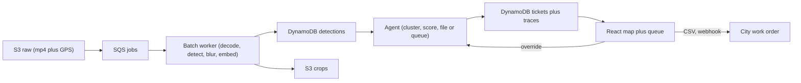

# CivicLens

Fleet dashcams file their own pothole tickets, with photo proof and a decision trace for every work order.

[](https://python.org)
[](https://react.dev)
[](LICENSE)

## Overview

CivicLens turns existing municipal fleets (garbage trucks, sweepers, buses) into road inspectors. A dashcam plus GPS unit records the road; the pipeline detects potholes and cracks, blurs faces and plates before storage, deduplicates repeat sightings of the same hole, scores severity, and files or queues a ticket. Road crews get a prioritized, geo-located list with photo evidence instead of a patrol backlog.

## Features

- Video plus GPS intake that queues work through S3 and SQS, so uploads survive restarts.
- YOLOv8n fused with a classical Canny fallback, so confident model hits win and weak frames still get a second opinion.
- Face and plate blurring before any crop is stored, with short raw-video retention.
- ORB embedding plus DBSCAN dedup that compresses repeat sightings into one ticket per hole.
- Weighted severity scoring with explicit file, review, and dismiss gates plus an arterial forced-review rule.
- Every decision trace-logged with its contributing factors, with human override that appends to the same trace.
- Map, review queue, video upload, and method views with CSV export for work orders.

## Quick start

Prerequisites: Docker with Compose, Python 3.11 (per `infra/Dockerfile.*`), Node 20 (per `infra/Dockerfile.web`).

```bash
# 1. Clone and enter
git clone https://github.com/Divyanshu-kumar14/CivicLens.git
cd CivicLens

# 2. Boot the full stack (API :8000, web :3000, LocalStack :4566, DynamoDB :8100)
docker compose up --build

# 3. Seed demo data in a second terminal (idempotent, safe to re-run)
make seed-demo

# 4. Open the map
xdg-open http://localhost:3000
```

Expect the Ward 12 demo: 5 seeded tickets (filed, pending, dismissed) with severity, repeat counts, and traces. When the API returns zero pending tickets the queue shows 3 client-side sample entries so the review flow is never empty; they yield to real data and never touch the API. Eight pothole demo crops in `web/public/demo-crops/` back the ticket drawer until real S3 crops exist.

## Usage

Interactive API docs live at `http://localhost:8000/docs` when the stack runs.

Queue a video already in object storage (JSON intake):

```bash
curl -X POST http://localhost:8000/jobs \
  -H "Content-Type: application/json" \
  -d '{"video_url": "s3://civic-lens-raw/route.mp4", "gps_url": "s3://civic-lens-raw/route.csv", "ward": "ward-12-demo"}'
# {"job_id": "<id>", "status": "queued"}
```

Upload from disk (multipart intake, what the web Upload view uses):

```bash
curl -X POST http://localhost:8000/jobs/upload \
  -F "video=@route.mp4" \
  -F "gps=@route.csv" \
  -F "ward=ward-12-demo"
```

Poll the job, then list tickets:

```bash
curl http://localhost:8000/jobs/<job_id>
curl "http://localhost:8000/tickets?status=pending&sort=severity"
curl http://localhost:8000/tickets/t_hole01
```

Human override appends to the same trace the agent writes:

```bash
curl -X POST http://localhost:8000/tickets/t_hole02/override \
  -H "Authorization: Bearer $WEBHOOK_SECRET" \
  -H "Content-Type: application/json" \
  -d '{"to": "filed", "reason": "confirmed on site"}'
```

Export filed tickets for the work-order system:

```bash
curl "http://localhost:8000/export.csv?status=filed" -o tickets-filed.csv
```

Video intake caps at 2 GB (`413` above that). Filenames must use `mp4/mov/avi/mkv` for video and `csv/srt` for GPS, or the API returns `422`.

## How it works



Uploads land in S3 and queue through SQS. The worker decodes, detects, blurs, and embeds; detections land in DynamoDB and crops in S3. The agent clusters sightings of the same hole, scores severity, and files, queues, or dismisses with a trace entry. The React app reads tickets, exports CSV or fires webhooks, and human overrides flow back into the agent.

Detection fusion (`vision/detector.py`): YOLO overlap with a classical box adds 0.1 confidence; large classical-only regions enter at 0.45; borderline YOLO hits get a focused ROI re-check; final pass re-runs NMS.

Severity (`agent/services/scorer.py`):

```
severity = 100 * (0.50 * area_norm + 0.25 * repeat_norm + 0.15 * route_w + 0.10 * lane_w)
```

At or above 70 files automatically; 40 to 69 queues for review; below 40 dismisses. Severity at or above 85 on an arterial route forces human review instead of auto-filing. Each ticket's signals carry the per-factor point contributions and the active thresholds, and its trace lists the factors behind the outcome (top contributor, repeat passes, bus proximity, lane position).

Dedup (`agent/services/cluster.py`): DBSCAN over a combined geo plus visual distance with `geo_eps_m = 15`, `cos_thresh = 0.82`, `min_samples = 2`. Lone weak hits (confidence at or below 0.5) are dismissed.

## Configuration

Tunables live in `config.yaml`; environment variables override for deployments. Copy `.env.example` to `.env` for real backends; local compose already sets the test endpoints.

```yaml
ward: "ward-12-demo"
dedup: { geo_eps_m: 15, cos_thresh: 0.82, min_samples: 2 }
severity: { w_area: 0.50, w_repeat: 0.25, w_route: 0.15, w_lane: 0.10,
  auto_file_threshold: 70, review_threshold: 40 }
privacy: { blur_faces: true, blur_plates: true, raw_retain_days: 14 }
detection: { model: "yolov8n", weights: "", conf_threshold: 0.25, nms_iou: 0.5,
  min_box_px: 24, classes: [pothole, crack] }
embedding: { dim: 128, method: "orb" }
```

Set `detection.weights` to a road-damage checkpoint path to replace the
shipped COCO weights (see `docs/TRAINING.md`); empty means hub `model` plus
classical fallback.

| Variable | Required | Default | Purpose |
|---|---|---|---|
| `AWS_REGION` | Yes | `us-east-1` | All AWS calls |
| `S3_RAW_BUCKET` / `S3_CROPS_BUCKET` | Yes | `civic-lens-raw` / `civic-lens-crops` | Uploaded video, blurred crops |
| `DYNAMO_TABLE_DETECTIONS` / `_TICKETS` / `_JOBS` | Yes | `cl-detections` / `cl-tickets` / `cl-jobs` | Table names |
| `SQS_QUEUE_URL` | For jobs | unset | Work queue; missing means `500 SQS_QUEUE_URL not configured` |
| `WEBHOOK_SECRET` | For webhooks | `changeme` | HMAC-SHA256 `X-CivicLens-Signature`; also the override bearer token when `ADMIN_SECRET` is unset |
| `ADMIN_SECRET` | No | falls back to `WEBHOOK_SECRET` | Bearer token required by `POST /tickets/{id}/override` |
| `CITY_WEBHOOK_URL` | For auto-file notify | unset | Worker delivery target |
| `CORS_ORIGINS` | No | `http://localhost:3000` | Comma-separated web origins |
| `AWS_ENDPOINT_URL` / `DYNAMO_ENDPOINT_URL` | Local only | unset | Point at LocalStack / DynamoDB-local |
| `AWS_ACCESS_KEY_ID` / `AWS_SECRET_ACCESS_KEY` | Local only | `test` / `test` | Local emulator credentials |
| `CIVICLENS_CONFIG` | No | `config.yaml` | Alternate config path |
| `METRICS_ENABLED` | No | `1` | CloudWatch metrics toggle |

Key knobs: raise `dedup.geo_eps_m` for fewer, larger clusters (safe range 10 to 30 m); raise `dedup.cos_thresh` for stricter visual match (0.75 to 0.90); raise `severity.auto_file_threshold` to file less aggressively (60 to 80); lower `detection.conf_threshold` to catch more at the cost of queue noise (0.15 to 0.40).

## Tech stack

- Vision: Python 3.11, OpenCV, Ultralytics YOLOv8n, ORB embeddings.
- Agent: FastAPI, Pydantic, scikit-learn DBSCAN, boto3 over DynamoDB, S3, SQS.
- Web: React 19, Vite, Tailwind v4, Leaflet, Axios, Nginx proxy.
- Local AWS parity: LocalStack 3.0 (S3 plus SQS), DynamoDB-local.
- Deploy: Docker, EC2 Graviton option, CloudWatch dashboard JSON in `infra/cloudwatch/`.

## Project structure

```
agent/       FastAPI triage: routes, cluster/score/file services, DynamoDB/S3 clients
vision/      OpenCV pipeline: detector, classical fallback, blur, embedder, GPS
web/src/     React map, review queue, upload, ticket drawer, API client
infra/       Compose stacks, Dockerfiles, Nginx proxy, AWS setup scripts
eval/        Detector/dedup/severity evals, throughput bench, failure-cases log
scripts/     Demo seeder, GPS simulator, synthetic video, label helper
docs/        Living technical report, perf ledger, architecture diagram
config.yaml  Shared dedup/severity/privacy/detection tunables
```

`specs/` and run state (`.orchestrator/`, `.token-optimizer/`) are local-only and gitignored.

Docker images install pinned locks: `agent/requirements.lock`, `vision/requirements.lock`, and `web/package-lock.json`. `make install` uses the version ranges for local dev; the root `requirements.lock` is an index of the per-image locks (pip cannot parse its section headers).

## API reference

Base URL `http://localhost:8000`. Full shapes live in `agent/models/` and `/docs`.

| Method | Endpoint | Description |
|---|---|---|
| `GET` | `/health` | Liveness probe, returns `{"status": "ok", "service": "civiclens-agent"}` |
| `POST` | `/jobs` | Queue by URL (JSON `video_url`, `gps_url`, `ward`) |
| `POST` | `/jobs/upload` | Multipart upload (`video`, optional `gps`, `ward`) |
| `GET` | `/jobs/{job_id}` | Job status (`queued`, `processing`, `completed`, `failed`) plus progress; failures carry the cause, and re-delivering a completed job returns cached counts without re-filing tickets |
| `GET` | `/tickets?status=&sort=` | List; `status` is filed, pending, or dismissed; `sort` is severity or timestamp |
| `GET` | `/tickets/{ticket_id}` | Full ticket with signals and trace |
| `POST` | `/tickets/{ticket_id}/override` | Human override (`to`: filed, pending, or dismissed; `reason`); requires `Authorization: Bearer $ADMIN_SECRET` (falls back to `WEBHOOK_SECRET`) |
| `GET` | `/export.csv?status=filed` | CSV work-order export |
| `POST` | `/webhooks/test` | Signed webhook delivery check |

Exported tickets reject override with `409` until re-opened. Presigned crop URLs expire after 15 minutes and re-issue on read.

## Evaluation and limitations

Reproduce locally with `python eval/eval_dedup.py`, `python eval/eval_severity.py`, `python eval/eval_detector.py`, and `make bench`. Test suite runs with `make test`.

| Metric | Result | Target | Status |
|---|---|---|---|
| Dedup compression | 8.89x (80 sightings into 9 clusters) | Above 5x | Pass |
| Dedup precision / recall | 1.00 / 0.88 | Above 0.90 / 0.80 | Pass |
| Duplicate rate / false tickets per route | 0.11 (1 extra) / 0.0 | As low as possible | Informational |
| Severity rank agreement | Spearman rho 1.00 | At or above 0.70 | Pass |
| Classical fallback P/R (pothole) | 0.29 / 0.50 | N/A, fallback only | Informational |
| Classical P/R (crack) | No labeled samples | Needs crack boxes | Open |
| Fused YOLO plus classical | Needs pothole-trained weights | Above 0.70 P/R | Open |

Dedup, severity, and classical numbers above were re-run on 2026-10-11 on this machine and match the committed eval scripts. Throughput and bundle figures (ARM Ampere 356 ms per frame, ~139 KB gzip) are reported in `docs/report.md` and `docs/PERF.md`; rerun `make bench` and `vite build` before quoting them for your hardware. `make test` is green here: 62 passed in `agent/`, 33 passed plus 2 skipped in `vision/`.

What is real versus simulated: detection fusion, blur, ORB dedup, scoring gates, traces, override, CSV export, and the local AWS stack all run. YOLO ships COCO weights until pothole weights (RDD2020 or equivalent) are trained. Night, rain glare, speed-breaker, tar-patch, and GPS-drift splits are documented in `eval/failure_cases/README.md`.

## Deployment

```bash
./infra/scripts/setup-aws.sh
cp .env.example .env
CORS_ORIGINS=https://your-web-host \
WEBHOOK_SECRET=$(openssl rand -hex 32) \
docker compose -f infra/docker-compose.prod.yml up --build -d
```

Production uses real S3 (SSE-S3, 14-day raw lifecycle), DynamoDB on-demand with a `status-severity-index` GSI and 90-day detection TTL, SQS, and an EC2 role (`civiclens-ec2-role`) instead of access keys. The web Nginx proxies `/jobs`, `/tickets`, `/export.csv`, `/webhooks`, and `/health` to the agent. On the override route it injects `Authorization: Bearer $ADMIN_SECRET` server-side (the prod overlay sets that from `WEBHOOK_SECRET`), so the token is never shipped in the browser bundle. A CloudWatch dashboard template ships in `infra/cloudwatch/dashboard.json`.

## Privacy and responsible use

Faces and plates blur before storage (Haar cascades plus a plate-shape
fallback; the demo worker applies the same `PrivacyBlur` to crops — when
cascades are absent on a host the blur finds no regions and logs a warning,
so treat worker log output as the per-host verification, not the claim
here); raw video expires after 14 days; detections expire after 90 days;
storage uses SSE-S3; webhooks sign with HMAC-SHA256; crop URLs are 15-minute
presigned; CORS is allowlisted; every ticket ships as verify-on-site advisory
with no auto-dispatch.

Retention is enforced by production AWS controls (`infra/scripts/setup-aws.sh`:
raw-bucket 14-day lifecycle, detection-table 90-day TTL), **not** by the local
LocalStack bootstrap (`infra/scripts/init-localstack.sh` sets neither) —
do not cite local runs as retention proof. Sightings with missing or
out-of-range GPS are dropped before clustering (logged) instead of merging
into a null-island ticket.

## Known issues

| Issue | Impact | Status |
|---|---|---|
| YOLOv8n ships COCO weights | Low pothole recall until retrained | Train on RDD2020 or custom data |
| Classical P 0.29 | Noisy alone, gated in fusion | Fallback only by design |
| GPS drift splits one cluster | Duplicate ticket in eval (recall 0.88) | Tune `geo_eps_m`, add map matching |
| Night and rain glare | Misses or false positives | Needs trained weights or IR |
| Speed breakers and tar patches | Classical false positives | Suppressed by fusion, pending review |
| LocalStack pinned to 3.0 | 4.x needs a token | Stays on 3.0 for local dev |

## Contributing

```bash
git checkout -b feat/your-feature
make lint
make test
```

Python follows flake8 (max line 100) with type hints; web uses eslint plus Prettier; commits use Conventional Commits (`feat:`, `fix:`, `docs:`). Update `config.yaml` comments, `docs/report.md` numbers, and this README when behavior changes, and include `make test` output in the PR.

## Further reading

| Doc | Description |
|---|---|
| `docs/report.md` | Living technical report with measured numbers |
| `docs/TRAINING.md` | Training a road-damage checkpoint: data, command, validation |
| `docs/PERF.md` | Performance ledger of kept and dropped optimizations |
| `docs/arch_diagram.mmd` | Architecture diagram source |
| `eval/failure_cases/README.md` | Documented failure modes |
| `docs/cool_appendix.md` | COOL benchmark status (planned, not yet run) |

## License

MIT License, see [`LICENSE`](LICENSE) for details.

## Acknowledgments

Ultralytics for YOLOv8; OpenCV for vision plus ORB; scikit-learn for DBSCAN; FastAPI, React, and Leaflet for the stack; LocalStack for local AWS parity. Demo crops are Wikimedia Commons pothole photographs, see `web/public/demo-crops/ATTRIBUTION.txt` for authors and licenses.

> Built for cities that move.
> *CivicLens: the truck that knows every pothole should be the one that reports it.*
