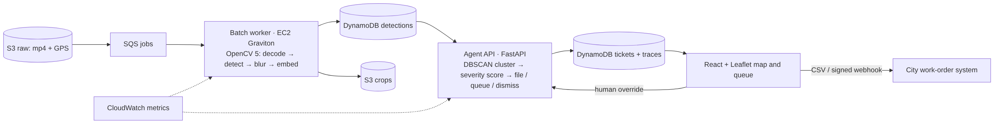

# CivicLens — Technical Report

> Status: living document. Measured numbers carry the command that reproduces
> them. Remaining gaps are marked inline: COOL needs Marketplace access (§7),
> and detector precision/recall needs pothole-trained weights (§8).

## 1. Problem & Impact

City road crews find potholes by patrol or by complaint, and both are slow.
A patrol samples the network instead of covering it; a complaint arrives
late, without a photo or a GPS fix, and usually several times for the same
hole. The work-order desk then triages without a severity signal, so a
cracked lane and a wheel-eating crater compete for the same crew. Nothing in
that loop produces before/after visual evidence, which is what contractors
and grant applications need.

The pixels already exist. Garbage trucks, sweepers and buses drive every
street on a weekly schedule with dashcams fitted. CivicLens attaches the
missing step: video plus GPS in, deduplicated and severity-ranked tickets
out, each with a photo and a decision trace.

The cost is not hypothetical:

- **$26.5B** was spent by US drivers on pothole-related repairs in 2021;
  1 in 10 drivers hit damage worth repairing, averaging almost $600
  ([AAA, 2022](https://newsroom.aaa.com/2022/03/aaa-potholes-pack-a-punch-as-drivers-pay-26-5-billion-in-related-vehicle-repairs/)).
- **2,161 people died** on Indian roads in 2023 in pothole-related crashes,
  up 16.4% year on year (Ministry of Road Transport & Highways annual report,
  as reported by
  [Times of India](https://timesofindia.indiatimes.com/india/potholes-claimed-2161-lives-in-2023-wrong-side-driving-9432/articleshow/123569966.cms)).
  The demo ward's coordinates (12.98 N, 77.59 E) are in Bengaluru, which sits
  in that network.

**Impact hypothesis, and how we would measure it.** One ward, one fleet, four
weeks: `median(detect → filed → fixed)` against the ward's current patrol
baseline, duplicates per route, and cost per 1,000 km. Concretely, a hole the
truck drives past tonight is filed the same night instead of waiting for the
next patrol cycle. We have not run that pilot — the numbers in §8 are from
synthetic and demo routes, and §9 lists what still fails.

## 2. Users & Buyer

| Persona | Job to be done | Pain today | What CivicLens gives them |
|---|---|---|---|
| **City road engineer (primary user)** | Clear the backlog, dispatch crews | Duplicate reports, no severity signal, no proof | Ranked queue: one ticket per hole, severity + crop + GPS, CSV/webhook into the existing work-order system |
| **Fleet operator (deployer)** | Runs the garbage/bus fleet, already owns the dashcams | Video is recorded and then discarded | Nightly upload (or USB dump) turns an existing asset into filed tickets |
| **Contractor (downstream)** | Repairs and bills the city | Disputed claims, no before/after evidence | Before/after crops attached to the ticket |
| **Citizen (indirect)** | Drives the road | Weeks of dodging the same hole | Faster repair; no app to install |

**Buyer:** municipality, ward office, fleet operator, or road-maintenance
contractor. The pilot offer is one ward, one fleet, four weeks, priced against
the ward's current patrol cost and measured on time-to-fix and duplicates per
route. Citizens never touch the v1 UI — that scope cut is deliberate.

## 3. Architecture
 (source: `arch_diagram.mmd`).
S3 raw → SQS jobs → Graviton/CPU batch worker (OpenCV 5:
decode→detect→blur→embed) →
DynamoDB detections + S3 crops → agent (cluster→score→file/queue) →
DynamoDB tickets + traces → React map/queue → CSV/webhook work orders.
Human override flows back into the agent with full trace.

## 4. OpenCV 5 Implementation
- `vision/detector.py`: YOLOv8n (conf 0.25, NMS 0.5, min-box 24px) fused with
  Canny+contour fallback (area>500, aspect 0.3–3.0); overlap boosts +0.1,
  large classical-only regions enter at 0.45; borderline band gets ROI re-check.
- `vision/classical.py`: blur→Canny(50/150)→dilate→RETR_EXTERNAL + perspective
  area (y-depth normalized) + center-lane check.
- `vision/embedder.py`: ORB-500 mean → 128-d unit norm (blank→zero vector);
  inputs capped at 128px (11.5→1.8ms/crop, quality identical — `docs/PERF.md`).
- `vision/blur.py`: Haar face + plate cascades (fetched at build; pip wheels
  ship empty data dirs), plate edge-density fallback, odd-strength guard.
- Measured on ARM Ampere (YOLOv8n, 2 vCPU): 356ms/frame. Classical-only
  key-frame eval: P=0.29 R=0.50 (`python eval/eval_detector.py`) — the fallback
  path, not the fused system; YOLO numbers need pothole-trained weights.

## 5. AWS Deployment
Live since 2026-10-10 (ap-southeast-2): EC2 `t4g.small` (Graviton/ARM) running
`agent-api` + `web` from `infra/docker-compose.prod.yml` (no local emulators).
Real backends via `infra/scripts/setup-aws.sh`: S3 `civic-lens-raw` (SSE-S3,
14-day lifecycle) + `civic-lens-crops`, DynamoDB `cl-detections` / `cl-tickets`
(GSI `status-severity-index`) / `cl-jobs` (90-day detection TTL), SQS
`civic-lens-jobs`. Instance role `civiclens-ec2-role` (S3/Dynamo/SQS/CW managed
policies) — no access keys anywhere. Endpoint: `http://3.25.238.76`
(map :80, API :8000, CORS allowlisted). Verified: seed → 5 tickets, job
enqueue → SQS, override + CSV export over the public URL; and on 2026-10-23 a
full upload → worker → cluster run over that URL (job completed in 4s, 21 raw
detections → 4 clusters, annotated video written to S3).
Open item (pre-pilot): ward-scoped IAM policy to replace managed full access.

## 6. Agentic Loop
perceive (cluster detail log) → decide (70/40 gates, arterial ≥85 forced
review) → act (file + webhook / queue / dismiss) → store (DynamoDB + trace).
Example — auto-filed ticket trace (real run, `TraceLogger.export_trace_jsonl`):
```jsonl
{"actor": "agent", "from_status": "new", "reasons": ["severity 73 >= 70"], "signals": {"area_norm": 46.1, "bus_route_w": 100.0, "center_lane": 100.0, "repeat": 100.0}, "to_status": "filed", "ts": "2026-10-09T18:31:56Z"}
```
Human override (same mechanism, `actor: human`):
```jsonl
{"actor": "human", "from_status": "pending", "reasons": ["confirmed on site"], "signals": {}, "to_status": "filed", "ts": "2026-10-10T00:00:00Z"}
```
Controls: override guard on exported tickets, threshold-adjustment logging
(future), arterial forced-review rule (implemented + tested).

## 7. COOL Benchmark
Stock-OpenCV baseline, demo clip (960×540 h264, 60s), decode→classical→ORB:
| Metric | x86 dev (16c) | ARM Ampere (2c) | Graviton+COOL c7g |
|---|---|---|---|
| Throughput (sampled) | 146.9 fps | 90.0 fps | TBD |
| Latency p95 | 2.3ms | 2.5ms | TBD |
| CPU% | 77% | 71% | TBD |
Reproduce: `make bench`. Full COOL comparison needs c7g access (see `cool_appendix.md`).

## 8. Evaluation Results
- Dedup (`python eval/eval_dedup.py`): **80 → 9 (8.89×, −88.8%), precision 1.00,
  recall 0.88** (one GPS-drift split, documented in `failure_cases/`).
- Severity (`python eval/eval_severity.py`): **Spearman rho=1.00 ≥ 0.70 PASS**
  (rank perfect; absolute calibration skews low on synthetic data).
- Detector: classical P=0.29 R=0.50 (fallback only); YOLO P/R needs weights + RDD2020.
- Full suite: 62 passed in `agent/`, 33 passed + 2 skipped in `vision/`
  (`make test`, verified 2026-10-23 in the pinned agent image).

## 9. Failure Cases
See `eval/failure_cases/README.md`: night drop, rain glare, speed breakers, tar
patches (expected, need real footage) + GPS-drift split (measured).

## 10. Responsible Use
Faces/plates blurred before storage; raw 14-day retention; detections TTL 90
days; SSE-S3; HMAC webhooks; 15-min presigned URLs; CORS allowlist via
`CORS_ORIGINS`; advisory ("verify on site") — no auto-dispatch; human override
always available.

## 11. Reproducibility
`docker compose up --build` → `make seed-demo` → http://localhost:3000.
`make bench`, `make test`, `make secrets`. Dependencies are pinned per image:
`vision/requirements.lock`, `agent/requirements.lock`, and
`web/package-lock.json`; the Dockerfiles install the lock files, not the
`requirements.txt` ranges.
